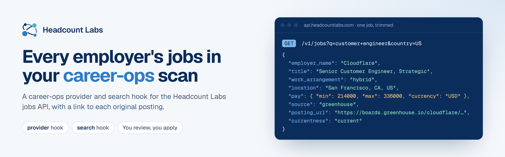

<p align="center">
  <a href="https://headcountlabs.com">
    <picture>
      <source media="(prefers-color-scheme: dark)" srcset=".github/assets/banner-dark.png">
      
    </picture>
  </a>
</p>

<p align="center">
  <a href="https://api.headcountlabs.com/data/signup"><b>Get a free API key</b></a> ·
  <a href="https://headcountlabs.com/docs/filters/"><b>Filter reference</b></a> ·
  <a href="https://headcountlabs.com/pricing/"><b>Pricing</b></a> ·
  <a href="https://github.com/career-ops-hq/career-ops"><b>career-ops</b></a>
</p>

# career-ops-plugin-headcountlabs

A community plugin for [career-ops](https://github.com/career-ops-hq/career-ops).

## What it does

It adds job search over the [Headcount Labs](https://headcountlabs.com) jobs API. The API serves postings collected from ATS boards and company career sites (Workday, Greenhouse, Lever, iCIMS and more than 100 other platforms). Postings of the same opening are linked into one job, and every job carries a link to the original posting.

The plugin gives career-ops two things:

- A **provider** for `portals.yml`. Each entry is one saved search, for example "platform engineer, remote, US" or "everything at Stripe". It runs during `node scan.mjs`.
- A **search** hook for a one-off query: `node plugins.mjs run headcountlabs search "staff data engineer"`.

Results go into your pipeline like any other source. You review them and you apply. The plugin never submits anything.

## When to use it, and when not to

Use it to look across many employers at once without listing each company's board first.

For companies you already track, the zero-key providers in career-ops read the employer's board directly and are the better choice. This plugin reads a catalog, and a catalog can trail the employer's own page. Open the posting link before you act on a result.

## Install

```bash
# Once it is in the career-ops registry:
node plugins.mjs add headcountlabs

# Before listing (install from this repo at a pinned commit):
node plugins.mjs add headcountlabs/career-ops-plugin-headcountlabs --sha <40-hex-commit>
```

Then enable it and record your consent:

```bash
node plugins.mjs enable headcountlabs            # shows the capability card
node plugins.mjs enable headcountlabs --confirm  # grants it
```

## Get a key

1. Open <https://api.headcountlabs.com/data/signup>. Sign up with Google, or with an email and a password. No card is asked for.
2. After sign-up you land on the account pages. Open **API keys** (<https://api.headcountlabs.com/data/keys>) and create a key.
3. Put the key in your `.env`:

```env
HEADCOUNTLABS_API_KEY=your_key_here
```

Every organization gets 1,000,000 records (jobs returned) free each calendar month (UTC), with no card needed. After that, every record delivered costs a flat $0.01 per 1,000; see [pricing](https://headcountlabs.com/pricing/).

## Configure

Add saved searches to `portals.yml`:

```yaml
job_boards:
  - name: "Platform engineering, remote US"
    provider: headcountlabs
    filters:
      title_advanced: 'platform AND (engineer OR sre)'
      country: US
      work_arrangement: remote

tracked_companies:
  - name: "Stripe"
    provider: headcountlabs
    filters:
      company: Stripe
    max_jobs: 50
    since_days: 7
```

`filters` takes these API filters: `q`, `title`, `title_advanced`, `description_advanced`, `company`, `location`, `city`, `state`, `country`, `msa`, `work_arrangement`, `employment_type`, `source`, `exclude_source`, `pay_min`, `pay_currency`, `has_pay`. At least one of `q`, `title`, `title_advanced`, `description_advanced` or `company` is required. The [filter reference](https://headcountlabs.com/docs/) describes each one.

Two optional settings sit next to `filters` on an entry:

| Setting | Default | Meaning |
| --- | --- | --- |
| `max_jobs` | 25 | The most jobs one scan fetches for this entry. The ceiling is 250. |
| `since_days` | 2 | Fetch only jobs that entered the catalog in the last N days. `0` turns the window off. |

Defaults for every entry, and for the search hook, go in `config/plugins.yml`:

```yaml
plugins:
  headcountlabs:
    enabled: true
    max_jobs: 25
    since_days: 2
    search_filters:        # added to every `run headcountlabs search` query
      country: US
```

## Staying inside the allowance

Each job returned counts as one record. With the defaults (`max_jobs: 25`), a daily scan of 8 entries returns at most about 6,000 records a month, well inside the free 1,000,000. The plugin logs what is left after each request.

Keep `since_days` close to how often you scan. A daily scan with `since_days: 2` fetches each new job about twice. A wide window on a broad search fetches the same jobs on every scan.

When the allowance runs out, the plugin stops with a plain message and career-ops carries on with your other sources.

## What it sends and where

The plugin talks to one host, `api.headcountlabs.com`, through the career-ops guarded `ctx.fetch`. It sends your API key and the filters you configured. It sends nothing from your CV, tracker or reports, and it has no telemetry.

## Tests

```bash
node test/smoke.mjs      # hooks match the manifest
node test/behavior.mjs   # request building and job mapping against a recorded API page
```

Both run without the network.

## License

MIT
